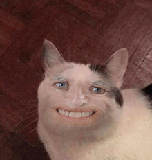
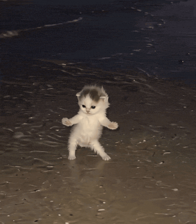

---
# try also 'default' to start simple
theme: default
# random image from a curated Unsplash collection by Anthony
# like them? see https://unsplash.com/collections/94734566/slidev
background: Globus.webp
# some information about your slides (markdown enabled)
title: Paul war hier
info: |
# apply UnoCSS classes to the current slide
class: text-center
# https://sli.dev/features/drawing
drawings:
  persist: false
# slide transition: https://sli.dev/guide/animations.html#slide-transitions
transition: slide-up
# enable Comark Syntax: https://comark.dev/syntax/markdown
comark: true
# duration of the presentation
duration: 35min
download: false
password: 'GIG'
---

<b>

Willkommen

 
zu einer Präsentation von Paul
</b>

<!--
The last comment block of each slide will be treated as slide notes. It will be visible and editable in Presenter Mode along with the slide. [Read more in the docs](https://sli.dev/guide/syntax.html#notes)
-->

---
transition: slide-down
class: text-left
layout: image-right
image: cat-thumbs-up.gif
---

Themen 

  
 
💬 Chatkontrolle
   
 
🍹 Zuckersteuer
   
  
🖥️ Brandenburg-  Monitor

---
transition: view-transition
layout: center
class: text-center
---

 Chatkontrolle

---
transition: slide-left
layout: image-right
image: Chatcontrolle_1.webp
---

 Was ist das?  

- digitale Nachrichten vor dem verschicken prüfen  
- gegen sexullen Kindesmissbrauch  
- gerade freiwillig  
- bis 2028

---
transition: slide-up
layout: image-left
image: Chatcontrolle_2.webp
---

 Warum?  

- Kinder vor sexuellen Missbrauch schützen  
- 2024 mehr als 40.000 regestrierte Fälle  
- unklar on wirksam  
- Problem: KI-unterstützung

---
transition: fade-out
layout: center
class: text-center
---

 Werden auch meine Chats gelesen?

---
transition: slide-right
layout: two-cols-header
---

 Werden auch meine Chats gelesen?  

::left::

 Unverschlüsselte Messenger🗒️

 Klartext liegt auf dem Server  Können gelesen werden  
z.B. SMS, Discord, Telegram  Chatkontrolle 1.0

::right::

 Verschlüsselte Messenger🔑

 Verschlüsselter Text liegt auf dem Server   Können <b>nicht</b> gelesen werden  
z.B. Whatsapp, Signal, Threema  Chatcontrolle 2.0

---
transition: view-transition
layout: center
class: text-center
---

 Zuckersteuer

---
transition: slide-down
layout: image-right
image: Zuckerwuerfel.webp
---

Was ist das?  

- Steuer auf besonders zuckerhaltige Getränke  
- im April festgelegt  
- ab 2027  
- mehr Geld für den Staat (bis 2.000.000.000€)  

---
transition: slide-right
layout: image-left
image: Zucker.jpeg
---

Wie gilt sie?  

Gilt für: 
- Softdrinks 
- Limonaden 
- nicht Zero-Getränke 
- nicht Saft und Milch 

Preise: 
- Ab 4,5g/100ml: 26ct  
- Ab 7,0g/100ml: 32ct 
- Ab 10,0g/100ml: 38ct 

---
transition: view-transition
layout: center
class: text-center
---

Brandenburg-    Monitor

---
transition: slide-up
layout: image-right
image: MuttaUndSohn.avif
---

Was ist das?  

- Potsdam  
- Arbeitsauftrag der Staatskanzlei  
- Umfrageinstitut Forsa  
- 1088 Befragte (ab 14 Jahren)  

---
transition: fade
layout: image-left
image: Trabant.jpg
---

Zahlen  

- 87% zufrieden mit Leben  
- 81% zufrieden mit Finanzen  
- 43% zufrieden mit ihrer Arbeit  
- 66% Angst um Zukunft der Kinder  
- 54% Land entwickelt sich falsch  
- -> Muster im Osten  

---
tansitition: slide-down
layout: iframe
url: https://landesregierung-brandenburg.de/wp-content/uploads/20261006_Praesentation_Brandenburg-Monitor-2026_.pdf
---

---
transition: fade
layout: default
---

 Quellen 

Text: 
https://www.tiktok.com/@hoodinformatik 
https://www.zeit.de/digital/datenschutz/2026-07/chatkontrolle-eu-messenger-kindesmissbrauch-faq 
https://www.br.de/nachrichten/deutschland-welt/zuckersteuer-wann-geht-es-los-und-was-wird-wie-viel-teurer,VTOOaGZ 
https://www.bundesregierung.de/breg-de/aktuelles/zuckergetraenkesteuer-2457018 
https://www.berliner-zeitung.de/article/brandenburg-monitor-zeigt-gute-gegenwart-duestere-zukunft-auch-anderswo-10471464 
https://landesregierung-brandenburg.de/wp-content/uploads/20261006_Praesentation_Brandenburg-Monitor-2026_.pdf 

Bilder: 
www.globus.de 
www.tenor.com 
pa/dpa/Sven Hoppe 
Getty Images/istock/Aphirak Thila 
Karsten Thielker/imago/imageBROKER 
Mick from England - Trabant (Panasonic G1), CC BY 2.0 

---
transition: fade
layout: end
---
       

 Danke fürs Zuhören!  

